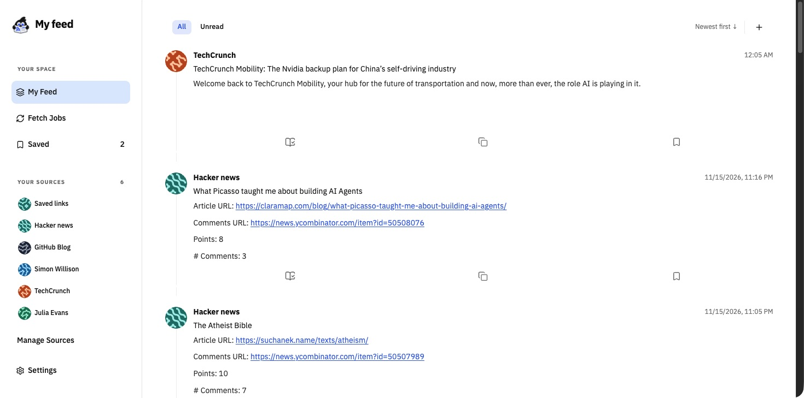

# My feed

<p align="center">
  
</p>

A self-hosted reader that brings RSS Sources and links you collect into one place. Read Entries, track what is unread, and bookmark favorites in Saved.



*Captured from the running app at `http://localhost:3000/`. Source content varies over time.*

## Features

- **One reading stream** — browse Entries newest first, filter unread Entries, or open a single Source.
- **Read and Saved state** — mark Entries as read and bookmark them in Saved.
- **Save Link** — record a URL in the built-in Saved links Source.
- **Source management** — add RSS Sources, edit their configuration, deactivate them, and reactivate them later. Existing Entries remain available.
- **Fetch Jobs** — fetch automatically on a fixed interval or trigger a Source manually; inspect active work and job history.
- **Local persistence** — keep Entries, Sources, and Fetch Jobs in a SQLite database.

## Quick start

Run commands from the repository root. You need Node.js compatible with Vite 8 (20.19+ or 22.12+), pnpm, and Docker Compose for the backend option below. Local backend development requires Go 1.25.7 or newer and Make.

Start the backend with Docker Compose:

```bash
make up
```

This builds the API, applies Goose migrations, and exposes it on port 8080. SQLite data persists in `backend/data/my-feed.db` on the host.

Install and start the frontend in another terminal:

```bash
cd frontend
pnpm install
pnpm dev
```

Open **http://localhost:3000/**. The Vite dev server proxies `/api` to `http://localhost:8080`. Check backend health at `http://localhost:8080/healthz`.

To begin, open **Manage Sources** and add an RSS Source. View **Fetch Jobs** to inspect fetching, or use **Save Link** to record a URL yourself. A fresh database does not include the example Sources shown in the screenshot.

### Run the backend without Docker

```bash
make migrate
make backend
```

Both commands default to `backend/data/my-feed.db`. Stop the API with Ctrl-C. Stop the Compose backend with `make down` before running a local backend on the same port.

## Configuration

The backend reads environment variables; defaults are listed in [backend/.env.example](backend/.env.example). Export overrides in your shell for local development. For Docker, configure the service environment in [backend/docker-compose.yml](backend/docker-compose.yml).

| Variable | Default | Purpose |
| --- | --- | --- |
| `DATABASE_PATH` | `data/my-feed.db` | SQLite path relative to the backend working directory; Compose uses `/data/my-feed.db` |
| `HTTP_ADDR` | `:8080` | API listen address |
| `FETCH_SCHEDULE_INTERVAL` | `15m` | Interval between automatic fetching rounds |
| `FETCH_RETRY_BACKOFF` | `1m` | Delay between Fetch Job retries |
| `FETCH_EXECUTOR_POLL` | `2s` | Interval for checking pending Fetch Jobs |
| `VITE_API_PROXY_TARGET` | `http://localhost:8080` | Backend target for the Vite development proxy |
| `VITE_API_BASE_URL` | `/api/v1` | Frontend API base URL; set before building when deploying elsewhere |

## Development

| Task | Command |
| --- | --- |
| Start frontend after installing dependencies | `make frontend` |
| Build backend binary | `make build` |
| Run backend unit and adapter tests | `make test-unit` |
| Run all backend tests | `make test` |
| Apply migrations | `make migrate` |
| Inspect migration status | `make migrate-status` |
| Roll back one migration | `make migrate-down` |
| Build frontend | `cd frontend && pnpm build` |
| Run frontend tests | `cd frontend && pnpm test` |
| Check frontend lint and formatting | `cd frontend && pnpm check` |

`make build` writes `backend/bin/server`. The frontend build writes `frontend/dist`; serve it with SPA route fallback and route API requests to the backend. Docker Compose currently runs the API only.

## Architecture

```text
my-feed/
├── frontend/          # React + TypeScript, Vite, TanStack Router/Query, Tailwind CSS
├── backend/           # Go modular monolith with hexagonal ports and adapters
│   ├── cmd/api/       # HTTP API and in-process Fetch Job scheduler/executor
│   ├── internal/      # Source, Entry, Fetch Job modules and platform code
│   ├── migrations/    # Goose SQL migrations
│   └── data/          # Persistent local SQLite database
├── bruno/my-feed/     # API request collection
└── docs/              # Architecture decisions, patterns, and agent guidance
```

The backend uses Chi, SQLite, and Goose. Fetch scheduling and execution run inside the API process; no separate worker or message broker is required. Each deployment supports **one backend instance** with its database on a **local filesystem**.

API resources live under `/api/v1/sources`, `/api/v1/entries`, and `/api/v1/fetch-jobs`. See the [Bruno collection](bruno/my-feed/README.md) for request examples.

## Project documentation

- [Domain glossary](GLOSSARY.md) — Entry, Source, Saved, and Fetch Job terminology.
- [Architecture decisions](docs/adr/) — module boundaries, fetching, and SQLite deployment.
- [Backend patterns](docs/patterns/README.md) — implementation conventions.
