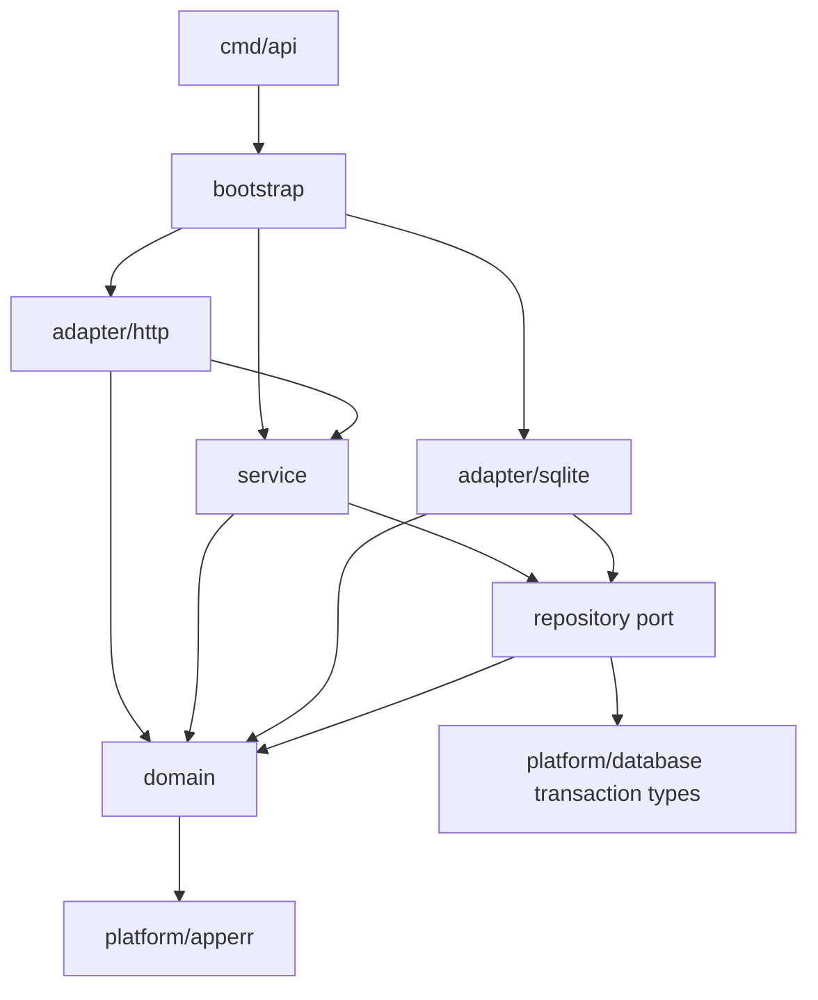

# Architecture

## Modular monolith

The Go backend runs as a single process and uses hexagonal architecture to keep business logic behind ports. Source and Entry own their respective domain rules. Fetch owns the Fetch Job lifecycle and coordinates with Source and Entry through injected ports. Bootstrap wires the modules and starts the in-process scheduler and executor. See [ADR 0001](../adr/0001-architecture.md) and [ADR 0002](../adr/0002-in-process-fetch.md).

## Dependency direction

Arrows show package dependencies.

Keep HTTP and SQLite dependencies in adapters. Services depend on repository contracts with explicit operations. Repository ports may use the shared transaction type for `WithTx`. Connect modules through injected ports and wire concrete adapters in bootstrap.

## Layer responsibilities

| Layer | Responsibility |
| --- | --- |
| Domain | Own aggregate invariants, initial state, and transitions. Define module-specific application errors. [Domain pattern](./domain.md) |
| Application service | Coordinate domain operations and persistence. Own transaction boundaries for operations that require atomic writes. [Application service pattern](./application.md) |
| Repository port and SQLite adapter | Declare persistence operations in the port. Implement SQL, row mapping, constraints, and storage error translation in the adapter. [Persistence pattern](./persistence.md) |
| HTTP adapter | Register routes, bind request DTOs, invoke services, and map results to response DTOs. [HTTP API pattern](./http.md) |
| Platform | Provide shared database and transaction primitives, typed errors, and HTTP helpers. [Application error pattern](./errors.md) |
| Bootstrap | Construct concrete dependencies, mount routes, and manage process-level wiring. [Module scaffold](./module-scaffold.md) |

## Consistency boundaries

An aggregate enforces its own invariants through domain methods. A use case can coordinate changes across aggregates or modules. When those writes must commit together, the use case uses the platform's `WithinTransaction` helper and binds participating repositories to the same transaction with `WithTx`. SQLite constraints and conditional updates enforce persistence invariants under concurrent writes.

## Deployment scope

The backend uses Gin, SQLite through `database/sql`, and Goose migrations. The API and fetch workers share the process. See the [SQLite deployment decision](../adr/0003-sqlite-for-self-hosting.md) for storage constraints. Introduce additional infrastructure or patterns such as an outbox, separate read models, or a separate worker process when a concrete requirement calls for them.
