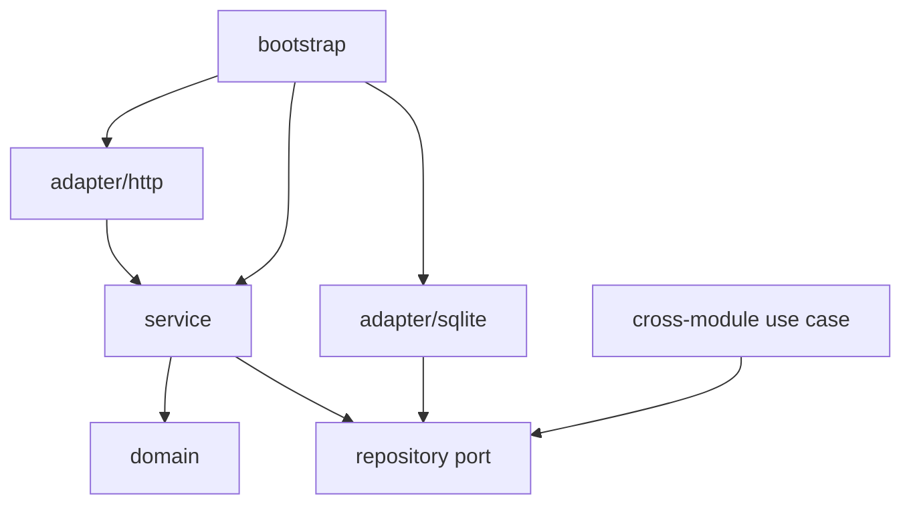

# Architecture

## สไตล์

**Modular monolith + hexagonal (ports & adapters)**

- แต่ละ business module เป็น bounded context ภายใน process เดียว
- Domain ไม่รู้จัก HTTP / SQL
- Application service คุยกับ persistence ผ่าน **repository port** (interface)
- Adapter อยู่ขอบนอก: `adapter/http`, `adapter/sqlite`
- Cross-module ผ่าน port ที่ inject — **ห้าม** import adapter ของ module อื่น



## Dependency direction (บังคับ)

```
cmd/ → bootstrap → (http adapters, services, SQLite adapters)
service → domain, repository (port)
adapter/http → service, domain (mapping เท่านั้น), platform
adapter/sqlite → domain, repository (implements port), platform
domain → platform/apperr เท่านั้น (ไม่ import service/adapter)
```

| อนุญาต | ห้าม |
|--------|------|
| `service` เรียก domain method | domain import `database/sql` / `gin` / HTTP types |
| `service` พึ่ง `repository.Repository` interface | module A import `moduleB/adapter/sqlite` |
| cross-module ใช้ port ของหลาย module | generic `Save(any)` เป็น API หลักของ repo |
| DB constraint + conditional UPDATE เสริม domain | public setter ที่ข้าม state machine |

## ชั้นความรับผิดชอบ

| ชั้น | รับผิดชอบ |
|------|-----------|
| **domain** | Invariants, state transitions, factory (`New…`) |
| **service** (module) | Load → domain method → persist |
| **service** (use case) | Orchestrate หลาย aggregate ใน 1 transaction |
| **repository port** | Explicit operations + `WithTx` |
| **adapter/sqlite** | SQL, map rows ↔ domain, map unique/check → `apperr` |
| **adapter/http** | Decode/encode JSON, status code, เรียก service |
| **platform** | Pool/tx, `apperr`, HTTP write helpers |
| **bootstrap** | Wire dependencies, mount routes |

## Aggregate vs use case

- **Aggregate** = consistency boundary ใน module (`Product`, `Coupon`, `Order`)
- **Use case ข้าม module** (เช่น Checkout, Cancel-with-restitution) = application service คนละแพ็กเกจ ไม่ใช่ aggregate
- Use case เหล่านี้ถือ transaction ที่ `platform/database.Pool.WithinTransaction`

## ขอบเขตที่ตั้งใจตัดออก (อย่าเพิ่มตอน init ถ้ายังไม่จำเป็น)

- ORM / repository generic CRUD
- Domain events + outbox / message broker
- CQRS แยก read model
- Microservice ต่อ module
- Soft-delete / audit framework ทั้งระบบ
